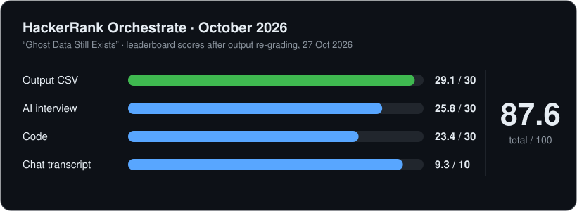
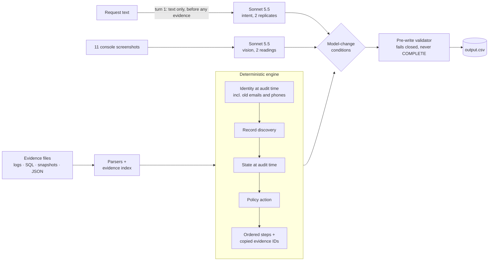
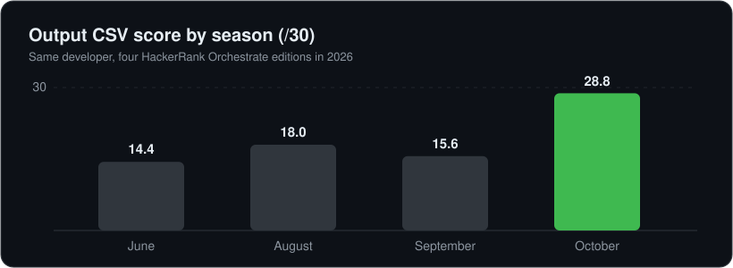

<div align="center">

# 👻 Ghost Data Still Exists

**A deletion-audit agent that proves whether a person's data is *really* gone.**

**Top 10 of 4,646 globally: HackerRank Orchestrate, October 2026** (24-hour hackathon)




</div>

---

## The problem

A company says "we deleted this user". Copies of that user's data can still sit in replicas, search indexes, caches, analytics, exports, support tools and backups, sometimes under an **old email or phone number**. For each of **518 deletion requests**, this system decides as of the audit time whether the person's data is really gone. It then writes the ordered **findings → remediation → verification** steps that prove it, and every step cites the evidence it rests on.

| Status | Meaning | Test rows |
|---|---|---:|
| `COMPLETE` | Authorised, and nothing remains; verification steps only, each citing evidence | 153 |
| `INCOMPLETE` | Something remains (or the row fails closed); findings + remediation + verification | 355 |
| `NOT_APPLICABLE` | The request never asked for deletion (export, access, correction…) | 10 |

## How it works

**The model interprets; the code decides.**



- **Intent is committed before any evidence is visible.** The model has to call `audit_case` with its intent and a verbatim quote from the request, and code checks the quote against the text. Nothing in an evidence file can talk it into, or out of, a deletion.
- **Everything else is code:** identity (exact matching only, so look-alikes never link), which records are the person's, each record's state at audit time, the policy action, the step order, and evidence IDs copied from the index and never composed.
- **Every model change has to justify itself.** Each run also computes the model-free row. A row the model changes keeps the change only if its condition holds: two agreeing intent replicates plus an intake record, or two agreeing screenshot readings with cross-checked IDs. Any unexplained difference stops the run.
- **The validator gates every row.** Enums, step order, the status↔steps invariants, ownership and the evidence rules are all checked. A row it can't make valid is written `INCOMPLETE`, never `COMPLETE`.

### One real row: `case_33`

An export file still holds the person's data at audit time, so the row is `INCOMPLETE`:

```text
1  FINDING       export_service   export_1842    REPORT_REMAINING_RECORD   PRESENT   evidence_18
2  REMEDIATION   export_service   export_1842    DELETE_RECORD             ABSENT
3  VERIFICATION  account_service  account_2373   VERIFY_RECORD_ABSENT      ABSENT
4  VERIFICATION  export_service   export_1842    VERIFY_RECORD_ABSENT      ABSENT
```

## Results

Every number names the run that produced it; the reports are generated from run artifacts and never hand-typed.

| What | Result | Run |
|---|---|---|
| DEV status (22 sample cases, in-sample) | **22 / 22** | `cand-dev-A-20261025T1352` |
| DEV rows exact | 19 / 22, step F1 0.989 (precision 1.000) | `cand-dev-A-20261025T1352` |
| Holdout, run once | 9 / 10 status, 8 / 10 rows, F1 0.974 · *optimistic* | `holdout-20261025T1628` |
| Model's effect vs model-free engine | 17 rows (10 intent, 7 screenshots) | `cand-test-Aplus-20261025T1352` |
| Intent replicate agreement | 375 / 375 distinct texts | `pass1-test-routing-20261025T1325` |
| Cost of the model replies the output uses | $14.10 · $0.027 per case | `code/evaluation/usage_report.md` |
| Final run | 0 model calls: a byte-exact replay from the reply cache | `freeze-test-Aplus-20261025T1629` |

<div align="center">

</div>

## Run it

```bash
python3 -m venv .venv
.venv/bin/python -m pip install -r requirements.txt
.venv/bin/python -B code/main.py --run-id demo --set test      # engine-only, no API key needed
.venv/bin/python -B -m unittest discover -s code/tests -t code  # 564 engine tests
```

Model runs need `ANTHROPIC_API_KEY` in a `.env` file and the `--paid --dollar-cap X --call-cap N` flags. The full reference is in **[docs/TECHNICAL_README.md](docs/TECHNICAL_README.md)**, the README that shipped with the submission.

## Honest limitations

- **On this data, the tool loop changes no rows.** Mode A+, mode A and tools-off produce byte-identical output. The model's measurable effect comes from the intent and screenshot readings.
- **A non-deletion request with no intake record falls back to a deletion plan.** It should fail closed instead. The shipped output is unaffected, because all 10 non-deletion readings have intake records.
- **Some account links rest on the dataset's job timing.** The rules are 1–2 s fingerprint bands, plus 27 hash-ordered tie picks. Every affected row is flagged.
- The rule *conditions* and retention dates aren't evaluated. No retention date in this data has expired yet.
- `case_34` may be a false `COMPLETE`, because its two screenshot readings disagree.

## How it was built

Built in about 17 hours, in one [Claude Code](https://claude.com/claude-code) session on Opus 5.5:
- A prep session researched the data and drafted the operating rules.
- In the build, task-specific subagents built each module to an approved interface.
- A fresh-context verifier reviewed every core diff, and red-team fixtures probed the edge cases.
- The holdout was locked until a single final run.

**Claude wrote the code. I chose the method, directed every gate and made the rulings.** There are 128 of them, in [`code/docs/DECISIONS.md`](code/docs/DECISIONS.md). Every turn is logged verbatim in [`log.txt`](log.txt).

<details>
<summary><b>Repository map</b></summary>

| Path | What |
|---|---|
| `code/deletion_audit/` | The agent: inputs, evidence parsers, identity, discovery, state, policy, steps, validator, model client, agent loop |
| `code/evaluation/` | DEV scorer, report generators, `evaluation_report.md`, `usage_report.md` |
| `code/tests/` | Engine tests, plus red-team and custom fixtures |
| `output.csv` | The submitted output (sha256 `a00ba71a…`) |
| `log.txt` | The turn-by-turn build transcript |
| `notes/` | Contract, forensics, architecture options, verifier and judge reports |
| `dataset/`, `problem_statement.md` | The organiser's challenge material |

</details>
